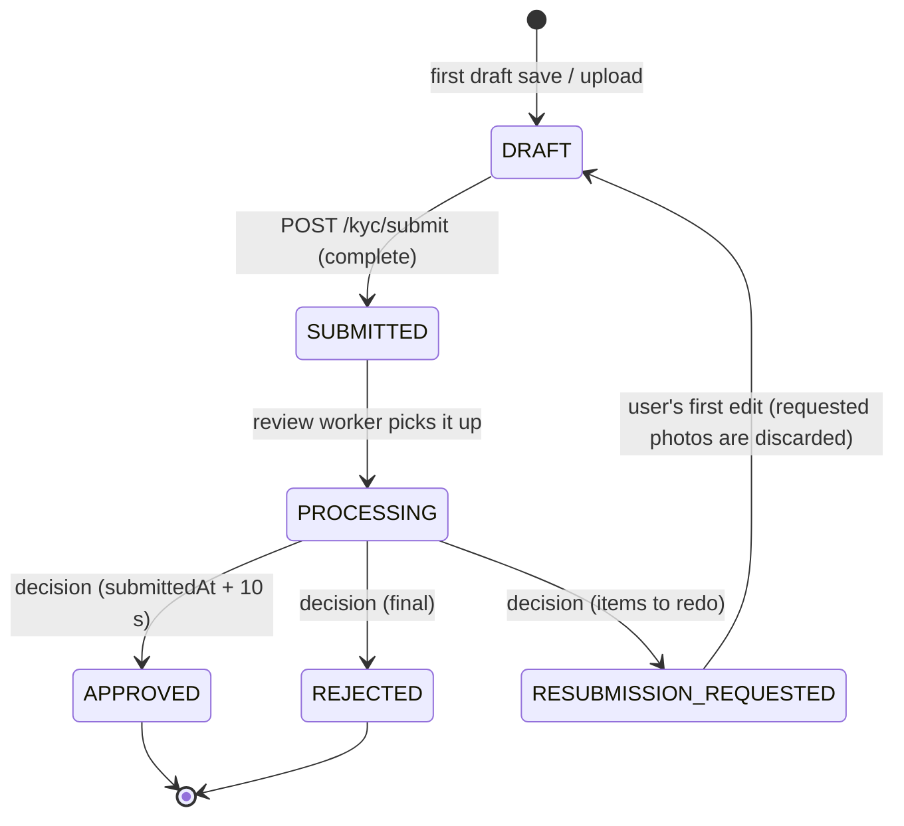

# KYC Onboarding API

**English** · [Tiếng Việt](README.vi.md)

Backend for the KYC Onboarding take-home assignment: a real REST API (no mocks) used by the
Flutter app in [`../kyc_app`](../kyc_app). It provides JWT authentication, a KYC state machine
with draft / resume, ID and selfie uploads to Cloudflare R2 / S3 (or local disk) behind presigned
URLs, and a simulated reviewer that decides about 10 seconds after submission. It runs as a Node
server or, unchanged apart from its infrastructure adapters, on **Cloudflare Workers + D1 + R2** (see
[Deploying to Cloudflare](#deploying-to-cloudflare-workers--d1--r2)).

> **System diagram:** open [`docs/system-architecture.html`](docs/system-architecture.html) in a browser
> (works offline) - architecture of both projects, KYC state machine, sequence diagrams for login /
> refresh, submission / review and direct upload, and a table of every system-to-system interaction.

**Stack:** Node.js ≥ 20 · TypeScript · Express 5 · Prisma 6 (SQLite by default, PostgreSQL-ready) ·
Zod · `@aws-sdk/client-s3` · JWT (`jsonwebtoken`) · bcrypt · multer · `node:test`

| Assignment requirement | Where |
|---|---|
| Authentication: login, session handling, logout | `/auth/*` - access + refresh JWT, rotation, reuse detection, rate limit |
| Personal details validation | Zod schemas `src/validators/kyc.schema.ts` (same rules as the app) |
| Document / selfie upload | Multipart or presigned PUT, magic-byte checks, private storage |
| Review & submit, edit | Draft endpoint, completeness report, submit merges over the draft |
| Verification status, rejection, resubmission | State machine + review worker; `REJECTED` vs `RESUBMISSION_REQUESTED` |
| Resume | Server-side draft with `currentStep`, completeness, history |
| Sensitive data, resilience, tests | See [Security](#pii--security), [Testing](#testing) |

---

## Quick start (no cloud credentials needed)

```bash
cp .env.example .env     # works as-is for local development (STORAGE_DRIVER=local)
npm install
npm run setup            # prisma generate + create / update the SQLite schema
npm run dev              # http://localhost:3000 (hot reload)

# in another terminal
npm run test:all         # typecheck + 58 unit/HTTP tests + 4 end-to-end tests
npm run smoke            # black-box run against the running server
```

> Run `npm run setup` again whenever `prisma/schema.prisma` changes (it updates the dev
> database and regenerates the Prisma client). Existing data is kept.

| Script | What it does |
|---|---|
| `npm run dev` | Start with hot reload (tsx) |
| `npm run build && npm start` | Compile `src/` to `dist/` (`tsconfig.build.json`) and run |
| `npm run setup` / `db:push` | Generate the Prisma client and sync the schema |
| `npm run typecheck` | `prisma generate` + `tsc --noEmit` over `src/`, `test/` and `scripts/` (`tsconfig.json`) |
| `npm test` | Unit + HTTP tests, no database needed (~1 s) |
| `npm run test:e2e` | API tests against a fresh throw-away SQLite DB (`prisma/test.db`) |
| `npm run test:all` | typecheck + all tests |
| `npm run smoke` | End-to-end run against a running server (`API_URL` to override) |
| `npm run db:studio` | Browse the database (http://localhost:5555) |
| `npm run db:migrate` | Versioned migrations (use once you move to PostgreSQL) |
| `npm run cf:dev` / `cf:deploy` | Run the Cloudflare Worker locally / deploy it (see [Deploying to Cloudflare](#deploying-to-cloudflare-workers--d1--r2)) |
| `npm run cf:db:migrate:local` / `:remote` | Apply `migrations/` to the local / remote D1 database |
| `npm run cf:typecheck` | Type-check the Worker entry with the generated Workers types |

Manual requests: `api.http` (VS Code REST Client / JetBrains HTTP client).

### Configuration

Every variable is validated at startup (`src/config/env.ts`); the process refuses to start with an
invalid config, and placeholder secrets are rejected when `NODE_ENV=production`.
`npm run dev` only reloads on source changes: **restart it after editing `.env`**.
`.env.example` documents all of them. The most important ones:

| Variable | Default | Purpose |
|---|---|---|
| `PUBLIC_BASE_URL` | `http://localhost:3000` | Base of local signed file URLs - must be reachable by the phone (see below) |
| `DATABASE_URL` | `file:./dev.db?connection_limit=1` | SQLite file (relative to `prisma/`) |
| `JWT_ACCESS_SECRET` / `JWT_REFRESH_SECRET` | placeholders | ≥ 32 chars, different from each other |
| `STORAGE_DRIVER` | `local` | `local` (disk + signed URLs) or `s3` (Cloudflare R2 / AWS S3 / MinIO) |
| `JWT_ACCESS_TTL_SECONDS` / `JWT_REFRESH_TTL_SECONDS` | `900` / `2592000` | Access token 15 min, refresh token 30 days |
| `KYC_REVIEW_WORKER_ENABLED` | `true` | Run the simulated reviewer (turn off to decide manually with the dev endpoint) |
| `KYC_AUTO_REVIEW_DELAY_MS` | `10000` | Delay between submission and decision |
| `KYC_AUTO_REVIEW_MODE` | `rule` | `rule`, `approve`, `reject`, `resubmit`, `random` |
| `ENABLE_DEV_ENDPOINTS` | `true` (not in production) | Exposes `POST /kyc/dev/review` |

### Using it from a phone

The app must reach the server, and image URLs are built from `PUBLIC_BASE_URL`, so both must use
the same address as the app's `API_BASE_URL`:

| Device | `PUBLIC_BASE_URL` |
|---|---|
| Android emulator or phone over USB (`adb reverse tcp:3000 tcp:3000`) / iOS simulator | `http://localhost:3000` |
| iPhone or any phone on the same Wi-Fi | `http://<Mac name>.local:3000` (`scutil --get LocalHostName`) or `http://<Mac IP>:3000` |

The server listens on all interfaces. Quick check from the phone's browser: `http://<address>:3000/health`.

---

## Architecture

```
src/
├── server.ts              # bootstrap: config, DB, HTTP server, review worker, graceful shutdown
├── app.ts                 # Express app: security headers, CORS, body parsing, routes, error handler
├── container.ts           # composition root (manual DI) - the only place implementations are wired
├── config/                # env.ts (Zod-validated config, fails fast), logger.ts
├── routes/                # URL -> middleware chain -> controller
├── controllers/           # HTTP adapters only: read validated input, call a service, shape the response
├── services/              # business logic: auth, KYC workflow, simulated reviewer
├── repositories/          # data access via Prisma; every state change is a conditional (race-safe) update
├── models/                # domain model: KYC state machine, document rules, resubmission items
├── storage/               # StorageProvider interface + S3/R2 and local-disk implementations
├── jobs/                  # KYC review worker (SUBMITTED -> PROCESSING -> decision)
├── middlewares/           # auth (JWT), validate (Zod), upload (multer), rate limit, request id/log, errors
├── validators/            # Zod schemas for every request
└── utils/                 # AppError, crypto helpers, magic-byte image sniffing, response helpers
prisma/schema.prisma       # User, RefreshToken, KycApplication, KycDocument, KycStatusHistory
test/                      # unit + HTTP (in-memory repositories) and e2e (real SQLite) tests
scripts/smoke-test.ts      # black-box test against a running server
docs/system-architecture.html  # system diagram (open in a browser)
tsconfig.json              # editor + typecheck: src, test, scripts (no emit)
tsconfig.build.json        # production build: src -> dist
worker/                    # Cloudflare Workers entry: Express on Workers, Prisma on D1, review Durable Object
migrations/                # D1 schema (SQL) for Wrangler
wrangler.jsonc             # Cloudflare config: vars, D1, R2, Durable Object, cron
```

Dependencies only point inward: **Controller → Service → Repository → Prisma model**. Services
depend on the `StorageProvider` interface, not on S3 or the file system.

### KYC state machine



- Transitions are declared once in `src/models/kyc.model.ts` and enforced in the repository with
  `UPDATE ... WHERE id = ? AND status = ?` inside a transaction, plus an audit row in
  `KycStatusHistory`. Two concurrent requests (or two worker instances) can never apply the same
  transition twice.
- Data is editable only in `DRAFT`; a `RESUBMISSION_REQUESTED` application is re-opened as `DRAFT`
  on the first edit. Any other edit after submission returns `409 KYC_NOT_EDITABLE`.
- `GET /kyc` returns `allowedActions` and, while editable, a `completeness` report
  (`missingDocuments`, `fieldIssues`) so the app can resume exactly where the user stopped
  (together with the client-defined `currentStep`).

### Simulated review job

`src/jobs/kyc-review.worker.ts` polls the database every `KYC_REVIEW_POLL_INTERVAL_MS`:
`SUBMITTED → PROCESSING` immediately, then a decision once `submittedAt + KYC_AUTO_REVIEW_DELAY_MS`
(10 s) has passed. Polling the database (instead of a `setTimeout` per request) means pending
reviews survive restarts and the worker is safe to run on several instances. In production it would
be replaced by a queue (BullMQ / SQS) or a KYC vendor webhook; services and repositories would not change.
On Cloudflare the same `tick()` is driven by a Durable Object alarm instead of `setInterval`.

Decision rules (`KYC_AUTO_REVIEW_MODE=rule`, default) - designed so every outcome can be demoed:

| Full name / data | Outcome |
|---|---|
| contains "reject" | `REJECTED` (final) |
| contains "retake" - first submission only | `RESUBMISSION_REQUESTED` with `["SELFIE"]`; the resubmission is approved |
| ID expired at review time / a required photo missing | `RESUBMISSION_REQUESTED` with those items |
| anything else | `APPROVED` |

`POST /api/v1/kyc/dev/review` forces a decision immediately (dev only).

---

## Assumptions

The brief asks to "make an assumption and document it" where requirements are unclear:

- **Rejection vs. resubmission request.** The brief lists "handle rejection and resubmission
  requests" separately, so they are two outcomes:

  | Status | Meaning | The user can |
  |---|---|---|
  | `REJECTED` | Final decision (e.g. suspected fraud) | Nothing - contact support |
  | `RESUBMISSION_REQUESTED` | Fixable problem; `resubmissionItems` lists what to redo (`PERSONAL_DETAILS`, `ID_FRONT`, `ID_BACK`, `SELFIE`), `rejectionReason` explains why | Fix and resubmit. The first edit re-opens the application and deletes the requested photos so they must be retaken; the reviewer's message stays visible until the next submit |
- **One application per user**, with a full status history (audit trail).
- **Adults only**: date of birth must be at least 18 years ago; the ID must not be expired.
- **The reviewer is simulated** (rules above) - integrating a KYC vendor is out of scope.
- **Images** are JPEG / PNG / WEBP up to 5 MB (the app compresses to a few hundred KB).

---

## Data flow

There is **one database per environment and no database-to-database sync**. Every write goes
App → API → a single store; nothing is replicated or copied between stores.

| Environment | Relational data (users, applications, status history) | Photo bytes | Review trigger |
|---|---|---|---|
| **Cloudflare (production)** | **D1** (`kyc-db`) via Prisma + `@prisma/adapter-d1` | **R2** bucket `kyc-documents` (R2 binding) | Durable Object alarm (+ Cron) |
| **Local Node server** | SQLite file `prisma/dev.db` (or PostgreSQL) | `./storage` on disk (or an S3 / R2 bucket via the S3 API) | `setInterval` worker |

The local SQLite file and Cloudflare D1 are **independent**: accounts and applications created
locally are not in D1 and vice versa. The Durable Object holds no business data, only the alarm
that runs `KycReviewWorker.tick()`.

### What is stored where

| Data | Store | Notes |
|---|---|---|
| `User` (email, password hash) | D1 / SQLite | bcrypt hash only |
| `RefreshToken` | D1 / SQLite | SHA-256 hash only; rotation chain via `replacedById` |
| `KycApplication` (personal details, `status`, `currentStep`, `rejectionReason`, `resubmissionItems`) | D1 / SQLite | the draft **is** this row while `status = DRAFT` |
| `KycDocument` (type, storage `key`, content type, size) | D1 / SQLite | metadata only (+ sha256) - **no image bytes** |
| `KycStatusHistory` | D1 / SQLite | one row per status transition |
| Image bytes (ID front / back, selfie) | R2 / local disk / S3 | object key links it to `KycDocument.key`; never public |
| Access token / encrypted draft copy | **the device** (secure storage) | not stored on the server; the server draft is the source of truth for resume |

### How data moves

```
Save draft      App ── PUT /kyc/draft ───────────────────▶ API ──▶ D1: UPDATE KycApplication (status stays DRAFT)
                       (the app also keeps an AES-GCM encrypted copy on the device)

Upload photo    App ── POST /kyc/documents/:type ────────▶ API ──┬─▶ R2:  put object  kyc/<userId>/<appId>/<type>-<uuid>.<ext>
                       (multipart, or presigned PUT + /confirm)  └─▶ D1:  upsert KycDocument { key, size, type, sha256 }
                                                                  (an old object of the same type is deleted from R2)

Submit          App ── POST /kyc/submit ─────────────────▶ API ──▶ D1: merge payload over draft, validate,
                                                                      UPDATE ... WHERE status = 'DRAFT' → SUBMITTED
                                                                      + INSERT KycStatusHistory
                                                          └─ 202 ─▶ ctx.waitUntil → Durable Object: set alarm (+1 s)

Review          Durable Object alarm ──▶ KycReviewWorker.tick()
                       D1: SUBMITTED → PROCESSING → (after KYC_AUTO_REVIEW_DELAY_MS) APPROVED | REJECTED |
                           RESUBMISSION_REQUESTED, each a conditional UPDATE + a KycStatusHistory row.
                       The worker reads D1 only; it never touches R2.

Poll status     App ── GET /kyc/status ──────────────────▶ API ──▶ D1: SELECT status

View photo      App ── GET /kyc  (or /documents/:type) ──▶ API ──▶ D1: SELECT KycDocument → signs a short-lived
                                                                      /api/v1/files/<token> URL
                App ── GET /files/<token> ───────────────▶ Worker ─▶ R2: get object (token checked: HMAC + expiry)

Resubmission    App edits the flagged item (PUT draft / upload photo) ─▶ first edit: D1 RESUBMISSION_REQUESTED → DRAFT,
                the flagged KycDocument rows and their R2 objects are deleted; then submit again (the same path as Submit)
```

Ordering for uploads: the object is written to R2 **first**, then the `KycDocument` row is saved in D1.
If the application is no longer editable the new object is deleted again, and the replaced object is deleted
after the row is updated. Only if the process dies between the two writes can an unreferenced (private) object
remain in R2; the reverse order would leave a row pointing at nothing. A cleanup job for such orphans is listed
under "With more time".

### Schema changes (migration flow)

`prisma/schema.prisma` is the source of truth → `prisma migrate diff … --script` generates a SQL file in
`migrations/` → `wrangler d1 migrations apply kyc-db --local` (local D1) and `--remote` (production D1).
The local Node server uses `npm run setup` (`prisma db push`) on its own SQLite file. Existing data
is never copied between the two.

## API

Base URL: `/api/v1`. All KYC endpoints require `Authorization: Bearer <accessToken>`.

### Response envelope

```jsonc
// success
{ "success": true, "data": { ... } }
// error
{
  "success": false,
  "error": { "code": "VALIDATION_ERROR", "message": "Request validation failed",
             "details": [{ "field": "body.dateOfBirth", "message": "You must be at least 18 years old" }] },
  "requestId": "6f1c..."   // also in the X-Request-Id header - matches the server log line
}
```

| HTTP | `error.code` |
|---|---|
| 400 | `VALIDATION_ERROR`, `BAD_REQUEST` |
| 401 | `UNAUTHORIZED`, `INVALID_CREDENTIALS`, `INVALID_TOKEN`, `TOKEN_EXPIRED`, `INVALID_REFRESH_TOKEN`, `REFRESH_TOKEN_REUSED` |
| 403 | `FORBIDDEN` |
| 404 | `NOT_FOUND`, `KYC_NOT_FOUND` |
| 409 | `EMAIL_ALREADY_REGISTERED`, `KYC_NOT_EDITABLE`, `KYC_INVALID_TRANSITION` |
| 413 / 415 | `PAYLOAD_TOO_LARGE` / `UNSUPPORTED_MEDIA_TYPE` |
| 422 | `KYC_INCOMPLETE` (details = completeness report) |
| 429 | `TOO_MANY_REQUESTS` |
| 500 / 502 | `INTERNAL_ERROR` / `STORAGE_ERROR` |

### Auth

| Method | Path | Body | Result |
|---|---|---|---|
| POST | `/auth/register` | `{ email, password, fullName? }` | `201 { user, tokens }` |
| POST | `/auth/login` | `{ email, password }` | `200 { user, tokens }` |
| POST | `/auth/refresh` | `{ refreshToken }` | `200 { tokens }` (the old refresh token is revoked) |
| POST | `/auth/logout` | `{ refreshToken }` | `204` (idempotent) |
| GET | `/auth/me` | - | `200 { user }` |

`tokens = { tokenType: "Bearer", accessToken, expiresIn, refreshToken, refreshExpiresIn }`.
Password policy: 8-72 characters, upper + lower case + digit.

- Access token: HS256 JWT, 15 min, stateless.
- Refresh token: JWT with its own secret; only its SHA-256 hash is stored. It is **rotated** on
  every refresh; presenting an already-used refresh token is treated as theft and revokes the whole
  session family (`REFRESH_TOKEN_REUSED`). Logout revokes the family.
- Login compares against a dummy hash when the email does not exist (no user enumeration by timing).
- `register`, `login` and `refresh` are rate limited per IP.

### KYC

| Method | Path | Description |
|---|---|---|
| GET | `/kyc` | `{ status, allowedActions, application }` - `status` is `NOT_STARTED` when there is no application. Includes details, documents with short-lived view URLs, completeness, `rejectionReason`, `resubmissionItems`, history |
| GET | `/kyc/status` | Lightweight status for polling (includes `rejectionReason`, `resubmissionItems`) |
| PUT | `/kyc/draft` | Save any subset of personal details + `currentStep`. Provided fields are validated; missing ones are fine |
| POST | `/kyc/documents/:type` | Upload through the API (`multipart/form-data`, field `file`). `:type` = `id-front` \| `id-back` \| `selfie` |
| POST | `/kyc/documents/:type/upload-url` | `{ contentType, contentLength? }` → presigned **PUT** URL for direct upload to R2 / S3 |
| POST | `/kyc/documents/:type/confirm` | `{ key }` → verifies the uploaded object and attaches it |
| GET | `/kyc/documents/:type` | Fresh presigned view URL |
| POST | `/kyc/submit` | JSON or multipart with any personal-details fields + files `idFront`, `idBack`, `selfie`. Merged over the draft, then checked → `202 SUBMITTED` or `422 KYC_INCOMPLETE` (what was sent is still saved) |
| POST | `/kyc/dev/review` | Dev only: `{ decision: "APPROVED" \| "REJECTED" \| "RESUBMISSION_REQUESTED", reason?, items? }` |

Personal details (`PUT /kyc/draft`, `POST /kyc/submit`):

| Field | Rule |
|---|---|
| `fullName` * | 2-100 Unicode letters, spaces, `'.-` |
| `dateOfBirth` * | `YYYY-MM-DD`, at least 18 years old |
| `gender` | `MALE` \| `FEMALE` \| `OTHER` |
| `nationality` *, `country` * | ISO 3166-1 alpha-2 (`VN`) |
| `phoneNumber` | E.164 (`+84901234567`) |
| `addressLine1` *, `addressLine2`, `city` *, `stateProvince`, `postalCode` | |
| `idType` * | `NATIONAL_ID` \| `PASSPORT` \| `DRIVER_LICENSE` |
| `idNumber` * | 5-30 letters / digits / dashes (upper-cased) |
| `idIssueDate`, `idExpiryDate` * | `YYYY-MM-DD`; expiry in the future and after the issue date |

Required documents: `ID_FRONT` + `SELFIE`, plus `ID_BACK` unless `idType = PASSPORT`.

### Two upload paths

**A. Through the API** (what the app uses): `POST /kyc/documents/:type` or all files with
`POST /kyc/submit`. Files are buffered in memory (max `MAX_UPLOAD_SIZE_MB`), checked by magic bytes
and pushed to storage; nothing is written to the API server's disk.

**B. Direct to R2 / S3 with a presigned URL** - the image never transits the API server:

```
App ── POST /kyc/documents/selfie/upload-url {contentType} ──▶ API   (url, headers, key; TTL 10 min)
App ── PUT <url>  (headers: Content-Type) + bytes ───────────▶ R2/S3
App ── POST /kyc/documents/selfie/confirm {key} ────────────▶ API   (HEAD + range GET: owner, size, real type)
```

`Content-Type` is part of the signature; on confirm the API checks that the key belongs to this
user / application / document type, the size limit and the real file type, and deletes invalid
objects. With `STORAGE_DRIVER=local` the same flow works against `/api/v1/files/:token`
(HMAC-signed, expiring tokens).

---

## PII & security

- **Private storage.** Images are only reachable through presigned GET URLs that expire after
  `PRESIGNED_DOWNLOAD_TTL_SECONDS` (default 5 min), generated per request for the owner only.
- **Non-guessable keys** `kyc/<userId>/<applicationId>/<type>-<uuid>.<ext>`; replaced or rejected
  photos are deleted.
- **Content validation** by magic bytes (JPEG / PNG / WEBP); the client MIME type is never trusted.
- **Data minimisation:** once submitted, the ID number is masked in responses (`********1234`).
  KYC responses are sent with `Cache-Control: no-store`.
- **Logs** contain method, path, status, duration and request id only - never bodies, query strings
  (signed tokens) or PII.
- **At rest:** R2 encrypts all objects (AES-256). For AWS S3 enable default bucket encryption.
- Passwords hashed with bcrypt (cost 12); refresh tokens stored as SHA-256 hashes; Helmet headers;
  rate limits; request size limits; strict Zod schemas (unknown fields are rejected).
- Config fails fast; placeholder secrets are refused in production.

---

## Testing

```bash
npm run test:all    # typecheck + unit/HTTP (58) + e2e (4)
npm test            # unit + HTTP only, no database, ~1 s
npm run test:e2e    # real Prisma + a fresh SQLite database
npm run smoke       # against a running server: approved / rejected / resubmission flows
```

| Layer | Covered |
|---|---|
| Domain (`kyc-model`, `validation`) | Every allowed / forbidden status transition, final states, document rules, ID masking, magic-byte sniffing, all request schemas (age, calendar dates, expiry, unknown keys, multer bodies) |
| Security (`auth.service`, `local-storage`) | Password hashing, no user enumeration, refresh rotation + reuse detection, logout, access / refresh separation, expired / forged / `alg=none` JWTs, signed URL tampering and expiry, path traversal |
| Workflow (`kyc.service`, `review-worker`) | Drafts, photo replacement deletes the old object, presigned upload + confirm (ownership, disguised PDF), incomplete submit keeps data, locking after submit, passport rules, final rejection, the full resubmission loop, reviewer rules and delay, two workers racing |
| HTTP (`http-api`) | Error envelope + request id, field errors, malformed JSON, auth guard, `no-store`, content sniffing over multipart, 413, signed photo URLs, multipart submit → approval, refresh / logout |
| E2E (`test/e2e`) | The same flows through the real Prisma repositories, plus concurrent submits (conditional SQL update) |

Unit / HTTP tests run the real services and Express app on top of in-memory repositories that
implement the same contract as the Prisma ones (`test/helpers/in-memory-repositories.ts`), so they
are fast and need no database; the e2e suite covers the SQL side.

### Manual testing with the app

Each account has exactly one application, so use **a new email for every scenario**.

**Review outcomes** (rule mode, decided ~10 s after submission from the full name):

| Full name | Expected |
|---|---|
| `Nguyen Van A` | `APPROVED` → profile screen |
| `Reject Tester` | `REJECTED` - final, nothing can be edited (`PUT /kyc/draft` → `409 KYC_NOT_EDITABLE`) |
| `Retake Tester` | `RESUBMISSION_REQUESTED` (`SELFIE`) → retake the selfie and resubmit → `APPROVED` |

Watch the spelling: re**ject** is final, re**take** asks for a new selfie.

**Deciding manually** (any decision, any items): set `KYC_REVIEW_WORKER_ENABLED=false`, restart,
submit from the app, then:

```bash
TOKEN=$(curl -s localhost:3000/api/v1/auth/login -H 'Content-Type: application/json' \
  -d '{"email":"user@test.com","password":"Test1234"}' | sed -E 's/.*"accessToken":"([^"]+)".*/\1/')
curl -s localhost:3000/api/v1/kyc/dev/review -H "Authorization: Bearer $TOKEN" -H 'Content-Type: application/json' \
  -d '{"decision":"RESUBMISSION_REQUESTED","reason":"ID photo is blurry","items":["ID_FRONT","PERSONAL_DETAILS"]}'
```

`decision`: `APPROVED` | `REJECTED` | `RESUBMISSION_REQUESTED`; `items`: `PERSONAL_DETAILS`, `ID_FRONT`,
`ID_BACK`, `SELFIE`. Set the worker back to `true` afterwards.

**Session expiry:**

- *Silent refresh* - `JWT_ACCESS_TTL_SECONDS=30`, restart, **log in again** (tokens issued before the
  restart keep their old lifetime), wait > 30 s and do anything that calls the API. The log shows
  `401` → `POST /auth/refresh 200` → the original request `200`; the user notices nothing.
- *Forced logout* - also set `JWT_REFRESH_TTL_SECONDS=60`, log in again, leave the app idle > 60 s,
  then do something that calls the API → the refresh is rejected and the app returns to the login
  screen. Expiry is detected on the next request (the app does not run a timer), and every
  successful refresh issues a new refresh token, so an active user is never logged out.
- Restore `900` / `2592000` and restart.

**Offline:** stop the server (`Ctrl+C`) in the middle of the flow → the app keeps working from its
local draft (failed uploads show *Retry*); reopening the app shows an offline banner; start the
server again → *Retry* uploads, the next edit syncs the draft, and a submit sends any photo the
server does not have yet.

**Inspect the data:** `npm run db:studio` - `KycApplication` (status, `resubmissionItems`),
`KycStatusHistory` (full audit trail), `RefreshToken` (hashes only, rotation chain via `replacedById`).

---

## Deploying to Cloudflare (Workers + D1 + R2)

The same code runs on Cloudflare - Express, controllers, services, repositories and validation are
shared with the Node server. Only the infrastructure is swapped (`worker/`):

| Node server (`src/server.ts`) | Cloudflare Worker (`worker/index.ts`) |
|---|---|
| `app.listen()` | Express on the Workers `node:http` support (`httpServerHandler`, `nodejs_compat`) |
| SQLite file via Prisma | **D1** via Prisma + `@prisma/adapter-d1` (`worker/d1-prisma.ts`), schema in `migrations/` |
| Local disk / S3 API | **R2 binding** (`R2StorageProvider`): photos in R2, links are the usual HMAC-signed `/api/v1/files/:token` URLs |
| `setInterval` review worker | **Durable Object alarm** (`KycReviewScheduler`) runs the same `KycReviewWorker.tick()` every second while applications are pending; armed on submit, plus a 1-minute Cron safety net |
| `.env` | `vars` in `wrangler.jsonc` + `wrangler secret put` |

**Plan:** the **Workers Paid** plan is required in practice. On the Free plan a request may use only
10 ms of CPU, which bcrypt password hashing (register / login) and the Prisma query engine exceed.
The bundle is about 1.5 MB gzipped. Check current limits and pricing in the Cloudflare docs.

### One-time setup

```bash
npm install
npx wrangler login

npx wrangler d1 create kyc-db              # copy the printed database_id into wrangler.jsonc
npx wrangler r2 bucket create kyc-documents

# three different random secrets (paste the output of `openssl rand -base64 48` when asked)
npx wrangler secret put JWT_ACCESS_SECRET
npx wrangler secret put JWT_REFRESH_SECRET
npx wrangler secret put LOCAL_STORAGE_SIGNING_SECRET

npm run cf:db:migrate:remote               # creates the tables in D1
npm run cf:deploy                          # prints https://kyc-service.<subdomain>.workers.dev
```

Then set `PUBLIC_BASE_URL` in `wrangler.jsonc` to the printed URL (photo links are built from it) and run
`npm run cf:deploy` again. Check `https://<your-worker>/health` → `"storageDriver": "r2"`.

**App:** set `API_BASE_URL=https://kyc-service.<subdomain>.workers.dev` in `kyc_app/.env`, stop the app
and run it again. HTTPS needs no iOS ATS exception.

### Running the Worker locally

```bash
cp .dev.vars.example .dev.vars             # local secrets / overrides (git-ignored)
npm run cf:db:migrate:local
npm run cf:dev                             # http://localhost:8787 - local D1, R2 and Durable Objects
API_URL=http://localhost:8787 npm run smoke
```

Verified: the full smoke test (auth, refresh rotation and reuse detection, multipart and presigned
uploads, R2 downloads, approved / rejected / resubmission → approved) passes against `wrangler dev`.

### Day-to-day

| Task | Command |
|---|---|
| Live logs | `npx wrangler tail` |
| Type-check the Worker | `npm run cf:typecheck` |
| Query D1 | `npx wrangler d1 execute kyc-db --remote --command "SELECT email FROM User"` |
| Schema change | edit `prisma/schema.prisma`, then `npx prisma migrate diff --from-local-d1 --to-schema-datamodel prisma/schema.prisma --script --output migrations/0002_<name>.sql`, apply with `cf:db:migrate:local` / `cf:db:migrate:remote` |
| Decide a review manually | not available: `NODE_ENV=production` disables `/kyc/dev/review`; the name rules (reject / retake) still work |

### Cloudflare: trade-offs

- **No interactive transactions on D1.** The four repository methods that use `$transaction(async tx => …)`
  run their statements in sequence on D1 (`worker/d1-prisma.ts`). Race safety is unchanged because every
  guarded write is a conditional `UPDATE … WHERE status = ?` / `WHERE revokedAt IS NULL`; what is lost
  is all-or-nothing atomicity (a crash between two statements could leave a status change without its
  history row). The Node + SQLite / PostgreSQL deployment keeps full transactions.
- **Rate limiting is per isolate** (in-memory store). Use Cloudflare WAF rate-limiting rules for a
  global limit.
- **Photos go through the Worker** (signed `/files/:token` URLs) instead of R2 presigned URLs, so no R2
  API credentials are needed; the S3 driver below is still available for the Node server.

## Cloudflare R2 via the S3 API (Node server)

1. **Create a bucket**: Cloudflare dashboard → R2 → *Create bucket* (e.g. `kyc-documents`).
   Do **not** enable public access or the `r2.dev` subdomain.
2. **Create an API token**: R2 → *Manage R2 API Tokens* → *Create API token*, permission
   **Object Read & Write**, restricted to that bucket. Copy the Access Key ID and Secret Access Key.
3. **Configure `.env`**:

   ```dotenv
   STORAGE_DRIVER=s3
   R2_ACCOUNT_ID=<your account id>      # endpoint becomes https://<id>.r2.cloudflarestorage.com
   S3_REGION=auto
   S3_BUCKET=kyc-documents
   S3_ACCESS_KEY_ID=<access key id>
   S3_SECRET_ACCESS_KEY=<secret access key>
   ```
4. **CORS** - only needed if a *browser* (e.g. Flutter web) uses presigned URLs; native apps do not.
   Bucket → *Settings* → *CORS policy*:

   ```json
   [{ "AllowedOrigins": ["https://your-web-app.example"], "AllowedMethods": ["GET", "PUT"],
      "AllowedHeaders": ["Content-Type"], "MaxAgeSeconds": 3600 }]
   ```

The S3 client uses `requestChecksumCalculation: 'WHEN_REQUIRED'`: recent AWS SDK versions otherwise
add CRC32 checksum parameters that R2 and mobile clients doing presigned PUTs do not send.
AWS S3 and MinIO work with the same driver (see `.env.example`).

## Switching to PostgreSQL

Set `provider = "postgresql"` in `prisma/schema.prisma`, point `DATABASE_URL` at your database
(drop the SQLite-only `?connection_limit=1`) and run `npm run db:migrate`. No code changes: status
and type columns are strings validated in the domain layer.

---

## Design decisions & trade-offs

- **SQLite by default** - zero setup for reviewers; the schema is portable to PostgreSQL and D1.
- **Cloudflare as a second runtime, not a rewrite** - the Worker reuses the Express app and every layer
  below it; only database client, storage and the review trigger are adapted (`worker/`).
- **Submit merges over the draft** - the app can send everything in one multipart call or save step
  by step and submit `{}`. Partial data is saved even when the submit is rejected as incomplete.
- **Two upload paths** - multipart is the easiest to integrate; presigned PUT keeps PII bytes off the
  API servers. R2 does not support presigned POST policies, so size / type are enforced at confirm.
- **Database-polling worker** instead of in-memory timers - restart-safe and multi-instance-safe
  without adding Redis for an assignment.
- **Manual dependency injection** (`container.ts`) instead of a DI framework - explicit and easy to
  replace in tests.
- **`node:test`** instead of Jest / Vitest - no extra dependencies; in-memory repositories keep
  most tests database-free.

## With more time

- Field-level encryption of PII columns (KMS envelope encryption of `idNumber`, date of birth).
- Re-encode images server-side (`sharp`) and scan uploads for malware.
- A real KYC vendor (document authenticity, liveness, face match) behind the reviewer interface,
  with webhooks instead of polling.
- Queue-based worker (BullMQ / SQS), PostgreSQL + migrations, OpenAPI spec, structured audit log of
  who viewed documents, a cleanup job for orphaned R2 objects, data-retention job, access-token deny list on logout.

---

## Troubleshooting

| Symptom | Fix |
|---|---|
| `[config] Invalid environment configuration` at startup | Fix the listed variables in `.env` (see `.env.example`) |
| TypeScript errors mentioning a new column (e.g. `resubmissionItems`) | The Prisma client is outdated: `npm run setup` |
| Cloudflare: error 1102 / *Worker exceeded CPU time limit* | Workers Free plan (10 ms CPU): use the Workers Paid plan |
| Cloudflare: photos do not load | `PUBLIC_BASE_URL` in `wrangler.jsonc` is not the Worker URL - fix it and `npm run cf:deploy` |
| Cloudflare: `no such table: User` | Migrations not applied: `npm run cf:db:migrate:remote` (or `:local` for `cf:dev`) |
| IDE: `Cannot find name 'node:test'` / `'node:assert/strict'` in `test/` | Restart the TypeScript server (VS Code: *TypeScript: Restart TS Server*); `tsconfig.json` includes `test/` with Node types |
| A change in `.env` has no effect | Restart `npm run dev` (it only watches source files); log in again for new token lifetimes |
| `The database disk image is malformed` in `test:e2e` | Stale `prisma/test.db*` files: `rm -f prisma/test.db*` (the script now does it automatically) |
| The phone cannot reach the API | Check `http://<address>:3000/health` from the phone's browser; allow Node in the macOS firewall; on a real Android device run `adb reverse tcp:3000 tcp:3000` |
| Uploaded images do not load in the app | `PUBLIC_BASE_URL` differs from the app's `API_BASE_URL` |
| Start from a clean slate | `rm -rf storage prisma/dev.db* && npm run setup` (deletes all local users, applications and photos) |
