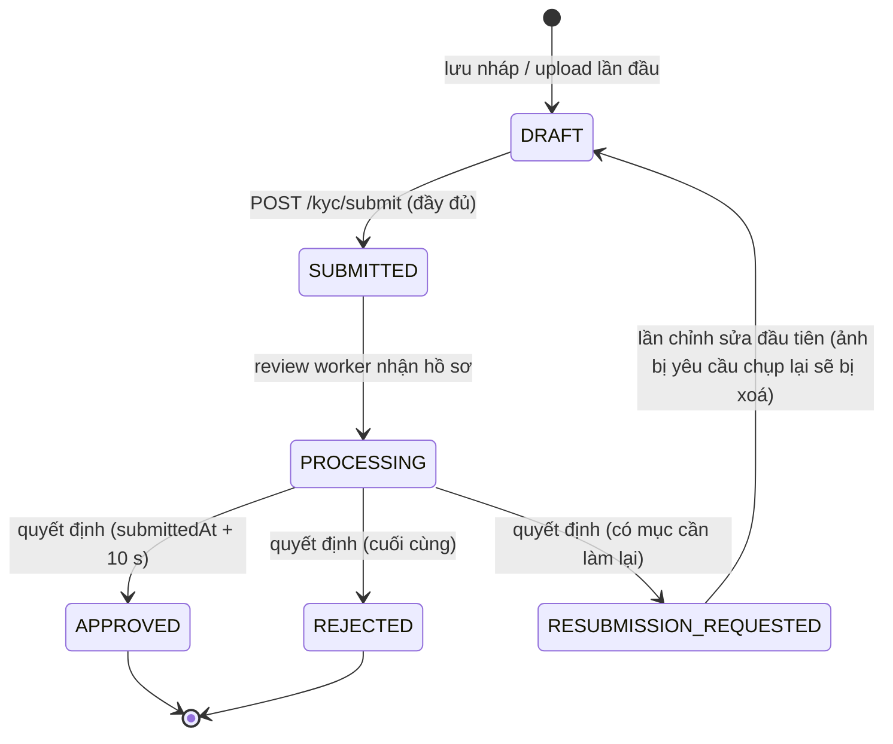

# KYC Onboarding API

[English](README.md) · **Tiếng Việt**

Backend cho bài tập KYC Onboarding: một REST API thật (không mock), được app Flutter trong
[`../kyc_app`](../kyc_app) sử dụng. Gồm xác thực JWT, state machine KYC có lưu nháp / tiếp tục,
upload ảnh giấy tờ và selfie lên Cloudflare R2 / S3 (hoặc ổ đĩa local) qua presigned URL, và một
reviewer giả lập đưa ra quyết định khoảng 10 giây sau khi nộp hồ sơ.

> **Sơ đồ hệ thống:** mở [`docs/system-architecture.html`](docs/system-architecture.html) bằng trình duyệt
> (không cần internet) - kiến trúc của cả hai project, state machine KYC, sequence diagram cho đăng nhập /
> refresh, nộp hồ sơ / xét duyệt và upload trực tiếp, cùng bảng mọi giao tiếp giữa các hệ thống.

**Công nghệ:** Node.js ≥ 20 · TypeScript · Express 5 · Prisma 6 (mặc định SQLite, sẵn sàng chuyển PostgreSQL) ·
Zod · `@aws-sdk/client-s3` · JWT (`jsonwebtoken`) · bcrypt · multer · `node:test`

| Yêu cầu của đề bài | Đáp ứng ở đâu |
|---|---|
| Xác thực: đăng nhập, quản lý phiên, đăng xuất | `/auth/*` - access + refresh JWT, xoay vòng token, phát hiện dùng lại token, giới hạn tần suất |
| Kiểm tra thông tin cá nhân | Zod schema `src/validators/kyc.schema.ts` (cùng quy tắc với app) |
| Upload giấy tờ / selfie | Multipart hoặc presigned PUT, kiểm tra magic bytes, lưu trữ riêng tư |
| Xem lại & nộp, chỉnh sửa | Endpoint lưu nháp, báo cáo mức độ hoàn thiện, submit gộp vào bản nháp |
| Trạng thái xác minh, từ chối, yêu cầu nộp lại | State machine + review worker; `REJECTED` khác `RESUBMISSION_REQUESTED` |
| Tiếp tục khi quay lại | Bản nháp phía server có `currentStep`, mức độ hoàn thiện, lịch sử |
| Dữ liệu nhạy cảm, khả năng chịu lỗi, test | Xem [Bảo mật](#pii--bảo-mật), [Kiểm thử](#kiểm-thử) |

---

## Chạy nhanh (không cần tài khoản cloud)

```bash
cp .env.example .env     # dùng ngay được cho môi trường local (STORAGE_DRIVER=local)
npm install
npm run setup            # prisma generate + tạo / cập nhật schema SQLite
npm run dev              # http://localhost:3000 (hot reload)

# ở terminal khác
npm run test:all         # typecheck + 58 test unit/HTTP + 4 test end-to-end
npm run smoke            # chạy kiểm thử hộp đen với server đang chạy
```

> Chạy lại `npm run setup` mỗi khi `prisma/schema.prisma` thay đổi (cập nhật database dev và
> sinh lại Prisma client). Dữ liệu hiện có được giữ nguyên.

| Script | Chức năng |
|---|---|
| `npm run dev` | Chạy với hot reload (tsx) |
| `npm run build && npm start` | Biên dịch `src/` ra `dist/` (`tsconfig.build.json`) và chạy |
| `npm run setup` / `db:push` | Sinh Prisma client và đồng bộ schema |
| `npm run typecheck` | `prisma generate` + `tsc --noEmit` cho `src/`, `test/` và `scripts/` (`tsconfig.json`) |
| `npm test` | Test unit + HTTP, không cần database (~1 giây) |
| `npm run test:e2e` | Test API với một database SQLite tạm, tạo mới mỗi lần (`prisma/test.db`) |
| `npm run test:all` | typecheck + toàn bộ test |
| `npm run smoke` | Chạy luồng end-to-end với server đang chạy (đổi địa chỉ bằng `API_URL`) |
| `npm run db:studio` | Xem database trên trình duyệt (http://localhost:5555) |
| `npm run db:migrate` | Migration có phiên bản (dùng khi chuyển sang PostgreSQL) |

Gọi API thủ công: file `api.http` (VS Code REST Client / JetBrains HTTP client).

### Cấu hình

Mọi biến môi trường được kiểm tra khi khởi động (`src/config/env.ts`); tiến trình sẽ không chạy nếu
cấu hình sai, và secret mặc định (placeholder) bị từ chối khi `NODE_ENV=production`.
`npm run dev` chỉ tự reload khi sửa source: **sửa `.env` xong phải restart**.
`.env.example` mô tả đầy đủ tất cả các biến. Các biến quan trọng nhất:

| Biến | Mặc định | Ý nghĩa |
|---|---|---|
| `PUBLIC_BASE_URL` | `http://localhost:3000` | Gốc của URL file đã ký (local) - điện thoại phải truy cập được (xem bên dưới) |
| `DATABASE_URL` | `file:./dev.db?connection_limit=1` | File SQLite (tương đối với thư mục `prisma/`) |
| `JWT_ACCESS_SECRET` / `JWT_REFRESH_SECRET` | placeholder | ≥ 32 ký tự, hai giá trị phải khác nhau |
| `STORAGE_DRIVER` | `local` | `local` (ổ đĩa + URL đã ký), `s3` (Cloudflare R2 qua S3 API / AWS S3 / MinIO) hoặc `r2` (R2 binding, chỉ dùng trong Worker) |
| `JWT_ACCESS_TTL_SECONDS` / `JWT_REFRESH_TTL_SECONDS` | `900` / `2592000` | Access token 15 phút, refresh token 30 ngày |
| `KYC_REVIEW_WORKER_ENABLED` | `true` | Bật reviewer giả lập (tắt đi để tự quyết định bằng dev endpoint) |
| `KYC_AUTO_REVIEW_DELAY_MS` | `10000` | Thời gian từ lúc nộp đến lúc có quyết định |
| `KYC_AUTO_REVIEW_MODE` | `rule` | `rule`, `approve`, `reject`, `resubmit`, `random` |
| `ENABLE_DEV_ENDPOINTS` | `true` (tắt ở production) | Bật `POST /kyc/dev/review` |

### Dùng với điện thoại

App phải gọi được tới server, và URL ảnh được tạo từ `PUBLIC_BASE_URL`, nên cả hai phải dùng
cùng địa chỉ với `API_BASE_URL` của app:

| Thiết bị | `PUBLIC_BASE_URL` |
|---|---|
| Android emulator hoặc điện thoại cắm USB (`adb reverse tcp:3000 tcp:3000`) / iOS simulator | `http://localhost:3000` |
| iPhone hoặc điện thoại bất kỳ cùng mạng Wi-Fi | `http://<tên Mac>.local:3000` (`scutil --get LocalHostName`) hoặc `http://<IP của Mac>:3000` |

Server lắng nghe trên mọi network interface. Kiểm tra nhanh bằng trình duyệt trên điện thoại:
`http://<địa chỉ>:3000/health`.

---

## Kiến trúc

```
src/
├── server.ts              # khởi động: config, DB, HTTP server, review worker, tắt an toàn (graceful shutdown)
├── app.ts                 # Express app: security headers, CORS, parse body, routes, xử lý lỗi
├── container.ts           # composition root (DI thủ công) - nơi duy nhất nối các implementation
├── config/                # env.ts (config kiểm tra bằng Zod, lỗi là dừng ngay), logger.ts
├── routes/                # URL -> chuỗi middleware -> controller
├── controllers/           # chỉ là adapter HTTP: đọc input đã validate, gọi service, định dạng response
├── services/              # nghiệp vụ: auth, quy trình KYC, reviewer giả lập
├── repositories/          # truy cập dữ liệu qua Prisma; mọi thay đổi trạng thái là update có điều kiện (an toàn khi chạy đồng thời)
├── models/                # domain model: state machine KYC, quy tắc giấy tờ, các mục cần nộp lại
├── storage/               # interface StorageProvider + implementation S3/R2 và ổ đĩa local
├── jobs/                  # KYC review worker (SUBMITTED -> PROCESSING -> quyết định)
├── middlewares/           # auth (JWT), validate (Zod), upload (multer), rate limit, request id/log, lỗi
├── validators/            # Zod schema cho mọi request
└── utils/                 # AppError, hàm mã hoá, nhận diện ảnh bằng magic bytes, helper response
prisma/schema.prisma       # User, RefreshToken, KycApplication, KycDocument, KycStatusHistory
test/                      # test unit + HTTP (repository trong bộ nhớ) và e2e (SQLite thật)
scripts/smoke-test.ts      # kiểm thử hộp đen với server đang chạy
docs/system-architecture.html  # sơ đồ hệ thống (mở bằng trình duyệt)
tsconfig.json              # cho editor + typecheck: src, test, scripts (không xuất file)
tsconfig.build.json        # build production: src -> dist
```

Phụ thuộc chỉ hướng vào trong: **Controller → Service → Repository → Prisma model**. Service
phụ thuộc vào interface `StorageProvider`, không phụ thuộc trực tiếp vào S3 hay hệ thống file.

### State machine KYC



- Các chuyển trạng thái được khai báo một lần trong `src/models/kyc.model.ts` và được repository
  thực thi bằng `UPDATE ... WHERE id = ? AND status = ?` trong một transaction, kèm một dòng audit
  trong `KycStatusHistory`. Hai request đồng thời (hoặc hai worker) không bao giờ áp dụng cùng một
  chuyển trạng thái hai lần.
- Chỉ sửa được dữ liệu khi ở `DRAFT`; hồ sơ `RESUBMISSION_REQUESTED` được mở lại thành `DRAFT`
  ở lần chỉnh sửa đầu tiên. Mọi chỉnh sửa khác sau khi nộp đều trả về `409 KYC_NOT_EDITABLE`.
- `GET /kyc` trả về `allowedActions` và, khi còn sửa được, báo cáo `completeness`
  (`missingDocuments`, `fieldIssues`) để app tiếp tục đúng chỗ người dùng dừng lại
  (cùng với `currentStep` do client lưu).

### Job review giả lập

`src/jobs/kyc-review.worker.ts` quét database mỗi `KYC_REVIEW_POLL_INTERVAL_MS`:
chuyển `SUBMITTED → PROCESSING` ngay, sau đó ra quyết định khi đã qua `submittedAt + KYC_AUTO_REVIEW_DELAY_MS`
(10 giây). Quét database (thay vì `setTimeout` cho từng request) giúp các hồ sơ đang chờ không bị
mất khi khởi động lại, và có thể chạy worker trên nhiều instance. Ở production sẽ thay bằng hàng đợi
(BullMQ / SQS) hoặc webhook từ nhà cung cấp KYC; service và repository không cần thay đổi.

Quy tắc quyết định (`KYC_AUTO_REVIEW_MODE=rule`, mặc định) - thiết kế để demo được mọi kết quả:

| Họ tên / dữ liệu | Kết quả |
|---|---|
| chứa "reject" | `REJECTED` (cuối cùng) |
| chứa "retake" - chỉ lần nộp đầu | `RESUBMISSION_REQUESTED` với `["SELFIE"]`; lần nộp lại được duyệt |
| giấy tờ hết hạn tại thời điểm duyệt / thiếu ảnh bắt buộc | `RESUBMISSION_REQUESTED` với các mục đó |
| còn lại | `APPROVED` |

`POST /api/v1/kyc/dev/review` ép ra quyết định ngay lập tức (chỉ dùng khi dev).

---

## Giả định

Đề bài yêu cầu "tự đưa ra giả định và ghi lại" khi yêu cầu chưa rõ:

- **Từ chối và yêu cầu nộp lại.** Đề bài ghi riêng "xử lý từ chối và yêu cầu nộp lại", nên đây là
  hai kết quả khác nhau:

  | Trạng thái | Ý nghĩa | Người dùng có thể |
  |---|---|---|
  | `REJECTED` | Quyết định cuối cùng (ví dụ nghi ngờ gian lận) | Không làm gì được - liên hệ hỗ trợ |
  | `RESUBMISSION_REQUESTED` | Lỗi có thể sửa; `resubmissionItems` liệt kê những gì cần làm lại (`PERSONAL_DETAILS`, `ID_FRONT`, `ID_BACK`, `SELFIE`), `rejectionReason` giải thích lý do | Sửa và nộp lại. Lần chỉnh sửa đầu tiên mở lại hồ sơ và xoá các ảnh bị yêu cầu để buộc chụp lại; lời nhắn của reviewer vẫn hiển thị đến lần nộp tiếp theo |
- **Mỗi người dùng một hồ sơ**, kèm toàn bộ lịch sử trạng thái (audit trail).
- **Chỉ người trưởng thành**: ngày sinh cách hiện tại ít nhất 18 năm; giấy tờ chưa hết hạn.
- **Reviewer là giả lập** (theo quy tắc ở trên) - tích hợp nhà cung cấp KYC nằm ngoài phạm vi.
- **Ảnh** là JPEG / PNG / WEBP, tối đa 5 MB (app nén xuống còn vài trăm KB).

---

## Luồng dữ liệu

Mỗi môi trường có **một database riêng và không có đồng bộ giữa các database**. Mọi thao tác ghi đi
App → API → một nơi lưu duy nhất; không có sao chép hay replicate giữa các nơi lưu.

| Môi trường | Dữ liệu quan hệ (user, hồ sơ, lịch sử trạng thái) | Byte ảnh | Cơ chế kích hoạt review |
|---|---|---|---|
| **Cloudflare (production)** | **D1** (`kyc-db`) qua Prisma + `@prisma/adapter-d1` | Bucket **R2** `kyc-documents` (R2 binding) | Alarm Durable Object (+ Cron) |
| **Server Node local** | File SQLite `prisma/dev.db` (hoặc PostgreSQL) | `./storage` trên ổ đĩa (hoặc bucket S3 / R2 qua S3 API) | Worker `setInterval` |

SQLite local và D1 trên Cloudflare **độc lập với nhau**: tài khoản / hồ sơ tạo ở local không có trên D1
và ngược lại. Durable Object không giữ dữ liệu nghiệp vụ, chỉ giữ alarm để chạy `KycReviewWorker.tick()`.

### Dữ liệu nằm ở đâu

| Dữ liệu | Nơi lưu | Ghi chú |
|---|---|---|
| `User` (email, hash mật khẩu) | D1 / SQLite | chỉ lưu hash bcrypt |
| `RefreshToken` | D1 / SQLite | chỉ lưu hash SHA-256; chuỗi xoay vòng qua `replacedById` |
| `KycApplication` (thông tin cá nhân, `status`, `currentStep`, `rejectionReason`, `resubmissionItems`) | D1 / SQLite | bản nháp **chính là** dòng này khi `status = DRAFT` |
| `KycDocument` (loại, `key` lưu trữ, content type, dung lượng) | D1 / SQLite | chỉ metadata - **không chứa byte ảnh** |
| `KycStatusHistory` | D1 / SQLite | mỗi lần chuyển trạng thái một dòng |
| Byte ảnh (mặt trước / sau giấy tờ, selfie) | R2 / ổ đĩa local / S3 | object key liên kết với `KycDocument.key`; không bao giờ công khai |
| Access token / bản nháp mã hóa | **thiết bị** (secure storage) | không lưu trên server; bản nháp trên server là nguồn chính khi resume |

### Dữ liệu di chuyển thế nào

```
Lưu nháp        App ── PUT /kyc/draft ───────────────────▶ API ──▶ D1: UPDATE KycApplication (status vẫn là DRAFT)
                       (app cũng giữ một bản mã hóa AES-GCM trên thiết bị)

Upload ảnh      App ── POST /kyc/documents/:type ────────▶ API ──┬─▶ R2:  ghi object  kyc/<userId>/<appId>/<type>-<uuid>.<ext>
                       (multipart, hoặc presigned PUT + /confirm) └─▶ D1:  upsert KycDocument { key, size, type, sha256 }
                                                                  (object cũ cùng loại bị xóa khỏi R2)

Submit          App ── POST /kyc/submit ─────────────────▶ API ──▶ D1: gộp payload lên bản nháp, validate,
                                                                      UPDATE ... WHERE status = 'DRAFT' → SUBMITTED
                                                                      + INSERT KycStatusHistory
                                                          └─ 202 ─▶ ctx.waitUntil → Durable Object: đặt alarm (+1 s)

Review          Alarm Durable Object ──▶ KycReviewWorker.tick()
                       D1: SUBMITTED → PROCESSING → (sau KYC_AUTO_REVIEW_DELAY_MS) APPROVED | REJECTED |
                           RESUBMISSION_REQUESTED, mỗi lần là một UPDATE có điều kiện + một dòng KycStatusHistory.
                       Worker chỉ đọc / ghi D1, không đụng tới R2.

Poll trạng thái App ── GET /kyc/status ──────────────────▶ API ──▶ D1: SELECT status

Xem ảnh         App ── GET /kyc  (hoặc /documents/:type) ▶ API ──▶ D1: SELECT KycDocument → ký URL ngắn hạn
                                                                      /api/v1/files/<token>
                App ── GET /files/<token> ───────────────▶ Worker ─▶ R2: đọc object (kiểm tra token: HMAC + hạn)

Resubmission    App sửa mục bị yêu cầu (PUT draft / upload ảnh) ─▶ lần sửa đầu: D1 RESUBMISSION_REQUESTED → DRAFT,
                xóa các dòng KycDocument bị yêu cầu làm lại và object R2 tương ứng; rồi submit lại (cùng đường đi với Submit)
```

Thứ tự khi upload: object được ghi vào R2 **trước**, sau đó mới lưu dòng `KycDocument` vào D1. Nếu hồ sơ không
còn sửa được thì object mới bị xóa lại, còn object cũ bị thay thế sẽ được xóa sau khi dòng được cập nhật. Chỉ khi
tiến trình chết giữa hai lần ghi mới có thể còn một object riêng tư không được tham chiếu trong R2; thứ tự ngược
lại sẽ để lại dòng trỏ tới file không tồn tại. Job dọn các object mồ côi như vậy nằm trong mục "Nếu có thêm thời gian".

### Thay đổi schema (luồng migration)

`prisma/schema.prisma` là nguồn chuẩn → `prisma migrate diff … --script` sinh file SQL trong `migrations/`
→ `wrangler d1 migrations apply kyc-db --local` (D1 local) và `--remote` (D1 production). Server Node local
dùng `npm run setup` (`prisma db push`) trên file SQLite riêng. Dữ liệu hiện có không bao giờ được sao
chép giữa hai bên.

## API

Base URL: `/api/v1`. Mọi endpoint KYC đều cần `Authorization: Bearer <accessToken>`.

### Định dạng response

```jsonc
// thành công
{ "success": true, "data": { ... } }
// lỗi
{
  "success": false,
  "error": { "code": "VALIDATION_ERROR", "message": "Request validation failed",
             "details": [{ "field": "body.dateOfBirth", "message": "You must be at least 18 years old" }] },
  "requestId": "6f1c..."   // cũng có trong header X-Request-Id - khớp với dòng log trên server
}
```

| HTTP | `error.code` |
|---|---|
| 400 | `VALIDATION_ERROR`, `BAD_REQUEST` |
| 401 | `UNAUTHORIZED`, `INVALID_CREDENTIALS`, `INVALID_TOKEN`, `TOKEN_EXPIRED`, `INVALID_REFRESH_TOKEN`, `REFRESH_TOKEN_REUSED` |
| 403 | `FORBIDDEN` |
| 404 | `NOT_FOUND`, `KYC_NOT_FOUND` |
| 409 | `EMAIL_ALREADY_REGISTERED`, `KYC_NOT_EDITABLE`, `KYC_INVALID_TRANSITION` |
| 413 / 415 | `PAYLOAD_TOO_LARGE` / `UNSUPPORTED_MEDIA_TYPE` |
| 422 | `KYC_INCOMPLETE` (details = báo cáo mức độ hoàn thiện) |
| 429 | `TOO_MANY_REQUESTS` |
| 500 / 502 | `INTERNAL_ERROR` / `STORAGE_ERROR` |

### Auth

| Method | Path | Body | Kết quả |
|---|---|---|---|
| POST | `/auth/register` | `{ email, password, fullName? }` | `201 { user, tokens }` |
| POST | `/auth/login` | `{ email, password }` | `200 { user, tokens }` |
| POST | `/auth/refresh` | `{ refreshToken }` | `200 { tokens }` (refresh token cũ bị thu hồi) |
| POST | `/auth/logout` | `{ refreshToken }` | `204` (gọi nhiều lần vẫn an toàn) |
| GET | `/auth/me` | - | `200 { user }` |

`tokens = { tokenType: "Bearer", accessToken, expiresIn, refreshToken, refreshExpiresIn }`.
Chính sách mật khẩu: 8-72 ký tự, có chữ hoa + chữ thường + chữ số.

- Access token: JWT HS256, 15 phút, không lưu trạng thái.
- Refresh token: JWT với secret riêng; chỉ lưu hash SHA-256. Token được **xoay vòng** mỗi lần
  refresh; dùng lại một refresh token đã dùng bị coi là bị đánh cắp và toàn bộ chuỗi phiên bị thu hồi
  (`REFRESH_TOKEN_REUSED`). Đăng xuất thu hồi cả chuỗi phiên.
- Khi email không tồn tại, login vẫn so sánh với một hash giả (không lộ email qua thời gian phản hồi).
- `register`, `login` và `refresh` bị giới hạn tần suất theo IP.

### KYC

| Method | Path | Mô tả |
|---|---|---|
| GET | `/kyc` | `{ status, allowedActions, application }` - `status` là `NOT_STARTED` khi chưa có hồ sơ. Gồm thông tin cá nhân, giấy tờ kèm URL xem ngắn hạn, mức độ hoàn thiện, `rejectionReason`, `resubmissionItems`, lịch sử |
| GET | `/kyc/status` | Trạng thái gọn nhẹ để polling (có `rejectionReason`, `resubmissionItems`) |
| PUT | `/kyc/draft` | Lưu một phần bất kỳ của thông tin cá nhân + `currentStep`. Trường gửi lên được validate; trường thiếu không sao |
| POST | `/kyc/documents/:type` | Upload qua API (`multipart/form-data`, field `file`). `:type` = `id-front` \| `id-back` \| `selfie` |
| POST | `/kyc/documents/:type/upload-url` | `{ contentType, contentLength? }` → presigned **PUT** URL để upload thẳng lên R2 / S3 |
| POST | `/kyc/documents/:type/confirm` | `{ key }` → kiểm tra object đã upload và gắn vào hồ sơ |
| GET | `/kyc/documents/:type` | Tạo presigned URL xem ảnh mới |
| POST | `/kyc/submit` | JSON hoặc multipart với bất kỳ trường thông tin cá nhân nào + file `idFront`, `idBack`, `selfie`. Gộp vào bản nháp rồi kiểm tra → `202 SUBMITTED` hoặc `422 KYC_INCOMPLETE` (dữ liệu đã gửi vẫn được lưu) |
| POST | `/kyc/dev/review` | Chỉ dev: `{ decision: "APPROVED" \| "REJECTED" \| "RESUBMISSION_REQUESTED", reason?, items? }` |

Thông tin cá nhân (`PUT /kyc/draft`, `POST /kyc/submit`):

| Trường | Quy tắc |
|---|---|
| `fullName` * | 2-100 ký tự chữ Unicode, khoảng trắng, `'.-` |
| `dateOfBirth` * | `YYYY-MM-DD`, ít nhất 18 tuổi |
| `gender` | `MALE` \| `FEMALE` \| `OTHER` |
| `nationality` *, `country` * | ISO 3166-1 alpha-2 (`VN`) |
| `phoneNumber` | E.164 (`+84901234567`) |
| `addressLine1` *, `addressLine2`, `city` *, `stateProvince`, `postalCode` | |
| `idType` * | `NATIONAL_ID` \| `PASSPORT` \| `DRIVER_LICENSE` |
| `idNumber` * | 5-30 chữ cái / chữ số / dấu gạch ngang (tự chuyển chữ hoa) |
| `idIssueDate`, `idExpiryDate` * | `YYYY-MM-DD`; ngày hết hạn ở tương lai và sau ngày cấp |

Giấy tờ bắt buộc: `ID_FRONT` + `SELFIE`, thêm `ID_BACK` trừ khi `idType = PASSPORT`.

### Hai cách upload

**A. Qua API** (app đang dùng cách này): `POST /kyc/documents/:type` hoặc gửi tất cả file trong
`POST /kyc/submit`. File được giữ trong bộ nhớ (tối đa `MAX_UPLOAD_SIZE_MB`), kiểm tra magic bytes
rồi đẩy lên storage; không ghi gì xuống ổ đĩa của API server.

**B. Upload thẳng lên R2 / S3 bằng presigned URL** - ảnh không đi qua API server:

```
App ── POST /kyc/documents/selfie/upload-url {contentType} ──▶ API   (url, headers, key; TTL 10 phút)
App ── PUT <url>  (headers: Content-Type) + bytes ───────────▶ R2/S3
App ── POST /kyc/documents/selfie/confirm {key} ────────────▶ API   (HEAD + range GET: chủ sở hữu, kích thước, loại file thật)
```

`Content-Type` nằm trong chữ ký; khi confirm, API kiểm tra key thuộc đúng người dùng / hồ sơ /
loại giấy tờ, giới hạn kích thước và loại file thật, rồi xoá các object không hợp lệ. Với
`STORAGE_DRIVER=local`, luồng này chạy tương tự qua `/api/v1/files/:token` (token ký HMAC, có hạn).

---

## PII & bảo mật

- **Lưu trữ riêng tư.** Ảnh chỉ truy cập được qua presigned GET URL hết hạn sau
  `PRESIGNED_DOWNLOAD_TTL_SECONDS` (mặc định 5 phút), tạo theo từng request và chỉ cho chủ sở hữu.
- **Key không đoán được** `kyc/<userId>/<applicationId>/<type>-<uuid>.<ext>`; ảnh bị thay thế hoặc
  bị yêu cầu chụp lại sẽ bị xoá.
- **Kiểm tra nội dung** bằng magic bytes (JPEG / PNG / WEBP); không bao giờ tin MIME type do client gửi.
- **Tối thiểu hoá dữ liệu:** sau khi nộp, số giấy tờ bị che trong response (`********1234`).
  Response KYC có `Cache-Control: no-store`.
- **Log** chỉ gồm method, path, status, thời gian xử lý và request id - không bao giờ có body,
  query string (token đã ký) hay PII.
- **Lưu trữ (at rest):** R2 mã hoá mọi object (AES-256). Với AWS S3 hãy bật mã hoá mặc định cho bucket.
- Mật khẩu hash bằng bcrypt (cost 12); refresh token lưu dạng hash SHA-256; header Helmet;
  giới hạn tần suất; giới hạn kích thước request; Zod schema chặt chẽ (trường lạ bị từ chối).
- Cấu hình sai là dừng ngay; secret placeholder bị từ chối ở production.

---

## Kiểm thử

```bash
npm run test:all    # typecheck + unit/HTTP (58) + e2e (4)
npm test            # chỉ unit + HTTP, không cần database, ~1 giây
npm run test:e2e    # Prisma thật + database SQLite mới tạo
npm run smoke       # với server đang chạy: luồng duyệt / từ chối / nộp lại
```

| Tầng | Nội dung được test |
|---|---|
| Domain (`kyc-model`, `validation`) | Mọi chuyển trạng thái được phép / bị cấm, trạng thái cuối, quy tắc giấy tờ, che số giấy tờ, nhận diện magic bytes, mọi request schema (tuổi, ngày hợp lệ, hết hạn, trường lạ, body từ multer) |
| Bảo mật (`auth.service`, `local-storage`) | Hash mật khẩu, không lộ email tồn tại, xoay vòng refresh + phát hiện dùng lại, đăng xuất, tách access / refresh, JWT hết hạn / giả mạo / `alg=none`, sửa URL đã ký và hết hạn, path traversal |
| Quy trình (`kyc.service`, `review-worker`) | Lưu nháp, thay ảnh thì xoá object cũ, presigned upload + confirm (quyền sở hữu, PDF giả ảnh), submit thiếu vẫn giữ dữ liệu, khoá sau khi nộp, quy tắc hộ chiếu, từ chối cuối cùng, toàn bộ vòng nộp lại, quy tắc và độ trễ của reviewer, hai worker chạy tranh nhau |
| HTTP (`http-api`) | Định dạng lỗi + request id, lỗi theo trường, JSON sai định dạng, chặn khi chưa đăng nhập, `no-store`, nhận diện nội dung qua multipart, 413, URL ảnh đã ký, submit multipart → duyệt, refresh / logout |
| E2E (`test/e2e`) | Các luồng trên qua repository Prisma thật, thêm submit đồng thời (update SQL có điều kiện) |

Test unit / HTTP chạy service và Express app thật trên các repository trong bộ nhớ có cùng hợp đồng
với repository Prisma (`test/helpers/in-memory-repositories.ts`), nên chạy nhanh và không cần
database; bộ e2e phủ phần SQL.

### Test tay cùng app

Mỗi tài khoản chỉ có đúng một hồ sơ, nên **mỗi kịch bản dùng một email mới**.

**Kết quả xét duyệt** (chế độ rule, quyết định khoảng 10 giây sau khi nộp, dựa vào họ tên):

| Họ tên | Kỳ vọng |
|---|---|
| `Nguyen Van A` | `APPROVED` → màn hình hồ sơ cá nhân |
| `Reject Tester` | `REJECTED` - kết thúc, không sửa được gì nữa (`PUT /kyc/draft` → `409 KYC_NOT_EDITABLE`) |
| `Retake Tester` | `RESUBMISSION_REQUESTED` (`SELFIE`) → chụp lại selfie và nộp lại → `APPROVED` |

Cẩn thận chính tả: re**ject** là từ chối hẳn, re**take** là yêu cầu chụp lại selfie.

**Tự quyết định bằng tay** (quyết định và mục bất kỳ): đặt `KYC_REVIEW_WORKER_ENABLED=false`, restart,
nộp hồ sơ trên app, rồi chạy:

```bash
TOKEN=$(curl -s localhost:3000/api/v1/auth/login -H 'Content-Type: application/json' \
  -d '{"email":"user@test.com","password":"Test1234"}' | sed -E 's/.*"accessToken":"([^"]+)".*/\1/')
curl -s localhost:3000/api/v1/kyc/dev/review -H "Authorization: Bearer $TOKEN" -H 'Content-Type: application/json' \
  -d '{"decision":"RESUBMISSION_REQUESTED","reason":"ID photo is blurry","items":["ID_FRONT","PERSONAL_DETAILS"]}'
```

`decision`: `APPROVED` | `REJECTED` | `RESUBMISSION_REQUESTED`; `items`: `PERSONAL_DETAILS`, `ID_FRONT`,
`ID_BACK`, `SELFIE`. Xong thì bật lại worker (`true`).

**Hết hạn phiên đăng nhập:**

- *Refresh ngầm* - đặt `JWT_ACCESS_TTL_SECONDS=30`, restart, **đăng nhập lại** (token cấp trước khi
  restart vẫn giữ thời hạn cũ), đợi hơn 30 giây rồi thao tác bất kỳ có gọi API. Log hiện `401` →
  `POST /auth/refresh 200` → request ban đầu `200`; người dùng không thấy gì.
- *Bị đăng xuất* - đặt thêm `JWT_REFRESH_TTL_SECONDS=60`, đăng nhập lại, để app đứng yên hơn 60 giây
  rồi thao tác có gọi API → refresh bị từ chối và app quay về màn hình đăng nhập. Việc hết hạn được
  phát hiện ở request kế tiếp (app không chạy timer), và mỗi lần refresh thành công lại cấp refresh
  token mới, nên người dùng đang thao tác sẽ không bao giờ bị đăng xuất.
- Trả lại `900` / `2592000` và restart.

**Mất kết nối:** tắt server (`Ctrl+C`) giữa chừng → app vẫn chạy từ bản nháp local (ảnh upload lỗi
hiện nút *Retry*); mở lại app thì có banner offline; bật server lại → bấm *Retry*, lần sửa tiếp theo
đồng bộ bản nháp, và khi submit app gửi kèm những ảnh server chưa có.

**Xem dữ liệu:** `npm run db:studio` - `KycApplication` (trạng thái, `resubmissionItems`),
`KycStatusHistory` (lịch sử đầy đủ), `RefreshToken` (chỉ lưu hash, chuỗi xoay vòng qua `replacedById`).

---

## Triển khai lên Cloudflare (Workers + D1 + R2)

Cùng một codebase chạy được trên Cloudflare - Express, controller, service, repository và validation
dùng chung với server Node. Chỉ phần hạ tầng được thay (`worker/`):

| Server Node (`src/server.ts`) | Cloudflare Worker (`worker/index.ts`) |
|---|---|
| `app.listen()` | Express chạy trên `node:http` của Workers (`httpServerHandler`, `nodejs_compat`) |
| File SQLite qua Prisma | **D1** qua Prisma + `@prisma/adapter-d1` (`worker/d1-prisma.ts`), schema trong `migrations/` |
| Ổ đĩa local / S3 API | **R2 binding** (`R2StorageProvider`): ảnh lưu trong R2, link vẫn là URL `/api/v1/files/:token` ký HMAC |
| Review worker dùng `setInterval` | **Alarm của Durable Object** (`KycReviewScheduler`) chạy cùng `KycReviewWorker.tick()` mỗi giây khi còn hồ sơ chờ; được kích hoạt khi submit, kèm Cron 1 phút làm lưới an toàn |
| `.env` | `vars` trong `wrangler.jsonc` + `wrangler secret put` |

**Gói dịch vụ:** thực tế cần gói **Workers Paid**. Gói Free chỉ cho 10 ms CPU mỗi request, không đủ cho
bcrypt (đăng ký / đăng nhập) và Prisma query engine. Bundle khoảng 1,5 MB (gzip). Xem giới hạn và giá
hiện tại trong tài liệu Cloudflare.

### Thiết lập một lần

```bash
npm install
npx wrangler login

npx wrangler d1 create kyc-db              # chép database_id được in ra vào wrangler.jsonc
npx wrangler r2 bucket create kyc-documents

# ba secret ngẫu nhiên khác nhau (dán kết quả của `openssl rand -base64 48` khi được hỏi)
npx wrangler secret put JWT_ACCESS_SECRET
npx wrangler secret put JWT_REFRESH_SECRET
npx wrangler secret put LOCAL_STORAGE_SIGNING_SECRET

npm run cf:db:migrate:remote               # tạo bảng trong D1
npm run cf:deploy                          # in ra https://kyc-service.<subdomain>.workers.dev
```

Sau đó đặt `PUBLIC_BASE_URL` trong `wrangler.jsonc` thành URL vừa in ra (link ảnh được tạo từ giá trị
này) rồi chạy lại `npm run cf:deploy`. Kiểm tra `https://<worker-của-bạn>/health` → `"storageDriver": "r2"`.

**App:** đặt `API_BASE_URL=https://kyc-service.<subdomain>.workers.dev` trong `kyc_app/.env`, tắt app
và chạy lại. HTTPS nên không cần ngoại lệ ATS trên iOS.

### Chạy Worker ở local

```bash
cp .dev.vars.example .dev.vars             # secret / giá trị override local (đã git-ignore)
npm run cf:db:migrate:local
npm run cf:dev                             # http://localhost:8787 - D1, R2, Durable Object local
API_URL=http://localhost:8787 npm run smoke
```

Đã kiểm chứng: smoke test đầy đủ (auth, xoay vòng refresh token và phát hiện tái sử dụng, upload
multipart và presigned, tải ảnh từ R2, approved / rejected / resubmission → approved) chạy qua với `wrangler dev`.

### Dùng hằng ngày

| Việc | Lệnh |
|---|---|
| Xem log trực tiếp | `npx wrangler tail` |
| Type-check Worker | `npm run cf:typecheck` |
| Truy vấn D1 | `npx wrangler d1 execute kyc-db --remote --command "SELECT email FROM User"` |
| Đổi schema | sửa `prisma/schema.prisma`, rồi `npx prisma migrate diff --from-local-d1 --to-schema-datamodel prisma/schema.prisma --script --output migrations/0002_<tên>.sql`, áp dụng bằng `cf:db:migrate:local` / `cf:db:migrate:remote` |
| Tự quyết định review | không dùng được: `NODE_ENV=production` tắt `/kyc/dev/review`; các quy tắc theo tên (reject / retake) vẫn hoạt động |

### Cloudflare: đánh đổi

- **D1 không có interactive transaction.** Bốn method repository dùng `$transaction(async tx => …)`
  chạy các câu lệnh tuần tự trên D1 (`worker/d1-prisma.ts`). Độ an toàn khi chạy đồng thời không đổi vì
  mọi lệnh ghi có điều kiện đều là `UPDATE … WHERE status = ?` / `WHERE revokedAt IS NULL`; thứ mất đi là
  tính all-or-nothing (nếu crash giữa hai câu lệnh, có thể đổi trạng thái mà thiếu dòng lịch sử).
  Triển khai Node + SQLite / PostgreSQL vẫn giữ transaction đầy đủ.
- **Rate limit theo từng isolate** (lưu trong bộ nhớ). Muốn giới hạn toàn cục thì dùng rule rate-limiting của Cloudflare WAF.
- **Ảnh đi qua Worker** (URL ký `/files/:token`) thay vì presigned URL của R2, nên không cần API
  credential của R2; driver S3 bên dưới vẫn dùng được cho server Node.

## Cấu hình Cloudflare R2 qua S3 API (server Node)

1. **Tạo bucket**: Cloudflare dashboard → R2 → *Create bucket* (ví dụ `kyc-documents`).
   **Không** bật public access hay subdomain `r2.dev`.
2. **Tạo API token**: R2 → *Manage R2 API Tokens* → *Create API token*, quyền
   **Object Read & Write**, giới hạn cho bucket đó. Sao chép Access Key ID và Secret Access Key.
3. **Cấu hình `.env`**:

   ```dotenv
   STORAGE_DRIVER=s3
   R2_ACCOUNT_ID=<account id của bạn>   # endpoint sẽ là https://<id>.r2.cloudflarestorage.com
   S3_REGION=auto
   S3_BUCKET=kyc-documents
   S3_ACCESS_KEY_ID=<access key id>
   S3_SECRET_ACCESS_KEY=<secret access key>
   ```
4. **CORS** - chỉ cần khi *trình duyệt* (ví dụ Flutter web) dùng presigned URL; app native thì không.
   Bucket → *Settings* → *CORS policy*:

   ```json
   [{ "AllowedOrigins": ["https://your-web-app.example"], "AllowedMethods": ["GET", "PUT"],
      "AllowedHeaders": ["Content-Type"], "MaxAgeSeconds": 3600 }]
   ```

S3 client dùng `requestChecksumCalculation: 'WHEN_REQUIRED'`: nếu không, các bản AWS SDK mới sẽ
thêm tham số checksum CRC32 mà R2 và client mobile dùng presigned PUT không gửi kèm.
AWS S3 và MinIO dùng cùng driver này (xem `.env.example`).

## Chuyển sang PostgreSQL

Đặt `provider = "postgresql"` trong `prisma/schema.prisma`, trỏ `DATABASE_URL` tới database của bạn
(bỏ `?connection_limit=1` vốn chỉ dành cho SQLite) rồi chạy `npm run db:migrate`. Không cần sửa code:
cột trạng thái và loại giấy tờ là chuỗi, được kiểm tra ở tầng domain.

---

## Quyết định thiết kế & đánh đổi

- **Mặc định SQLite** - người chấm không cần cài đặt gì; schema chuyển được sang PostgreSQL.
- **Submit gộp vào bản nháp** - app có thể gửi tất cả trong một lần multipart, hoặc lưu từng bước
  rồi submit `{}`. Dữ liệu dở dang vẫn được lưu kể cả khi submit bị từ chối vì thiếu.
- **Hai cách upload** - multipart dễ tích hợp nhất; presigned PUT giúp dữ liệu ảnh PII không đi qua
  API server. R2 không hỗ trợ presigned POST policy, nên kích thước / loại file được kiểm tra lúc confirm.
- **Worker quét database** thay vì timer trong bộ nhớ - an toàn khi khởi động lại và khi chạy nhiều
  instance, không cần thêm Redis cho một bài tập.
- **DI thủ công** (`container.ts`) thay vì framework DI - rõ ràng và dễ thay thế khi test.
- **`node:test`** thay vì Jest / Vitest - không thêm dependency; repository trong bộ nhớ giúp phần
  lớn test không cần database.

## Nếu có thêm thời gian

- Mã hoá PII theo từng cột (envelope encryption bằng KMS cho `idNumber`, ngày sinh).
- Encode lại ảnh phía server (`sharp`) và quét mã độc file upload.
- Tích hợp nhà cung cấp KYC thật (xác thực giấy tờ, liveness, so khớp khuôn mặt) sau interface
  reviewer, dùng webhook thay vì polling.
- Làm sâu hơn phần xác thực: xác minh email, đặt lại mật khẩu, MFA (TOTP / OTP SMS), gắn thiết bị với danh sách phiên có thể thu hồi, và deny list lưu bền để access token mất hiệu lực ngay khi đăng xuất hoặc bị buộc đăng xuất (hiện chúng còn sống tới khi hết hạn 15 phút).
- Làm sâu hơn phần AI nhận diện khuôn mặt sau interface reviewer: liveness / chống giả mạo, so khớp selfie với ảnh trên giấy tờ kèm điểm tin cậy, kiểm tra chất lượng ảnh, OCR giấy tờ đối chiếu với thông tin đã nộp, và hàng đợi duyệt thủ công cho điểm ở ngưỡng biên.
- Worker dùng hàng đợi (BullMQ / SQS), PostgreSQL + migration, đặc tả OpenAPI, audit log có cấu trúc
  ghi lại ai đã xem giấy tờ, job dọn object R2 mồ côi, job xoá dữ liệu theo chính sách lưu trữ, danh sách chặn access token khi đăng xuất.

---

## Xử lý sự cố

| Hiện tượng | Cách xử lý |
|---|---|
| `[config] Invalid environment configuration` khi khởi động | Sửa các biến được liệt kê trong `.env` (xem `.env.example`) |
| Lỗi TypeScript nhắc tới cột mới (ví dụ `resubmissionItems`) | Prisma client đã cũ: `npm run setup` |
| IDE báo `Cannot find name 'node:test'` / `'node:assert/strict'` trong `test/` | Restart TypeScript server (VS Code: *TypeScript: Restart TS Server*); `tsconfig.json` đã bao gồm `test/` với kiểu của Node |
| Sửa `.env` mà không có tác dụng | Restart `npm run dev` (nó chỉ theo dõi file source); đăng nhập lại để nhận thời hạn token mới |
| `The database disk image is malformed` khi chạy `test:e2e` | File `prisma/test.db*` cũ: `rm -f prisma/test.db*` (script giờ đã tự làm việc này) |
| Điện thoại không gọi được API | Mở `http://<địa chỉ>:3000/health` bằng trình duyệt trên điện thoại; cho phép Node trong tường lửa macOS; với máy Android thật chạy `adb reverse tcp:3000 tcp:3000` |
| Ảnh đã upload không hiện trong app | `PUBLIC_BASE_URL` khác với `API_BASE_URL` của app |
| Muốn làm lại từ đầu | `rm -rf storage prisma/dev.db* && npm run setup` (xoá toàn bộ người dùng, hồ sơ và ảnh local) |
